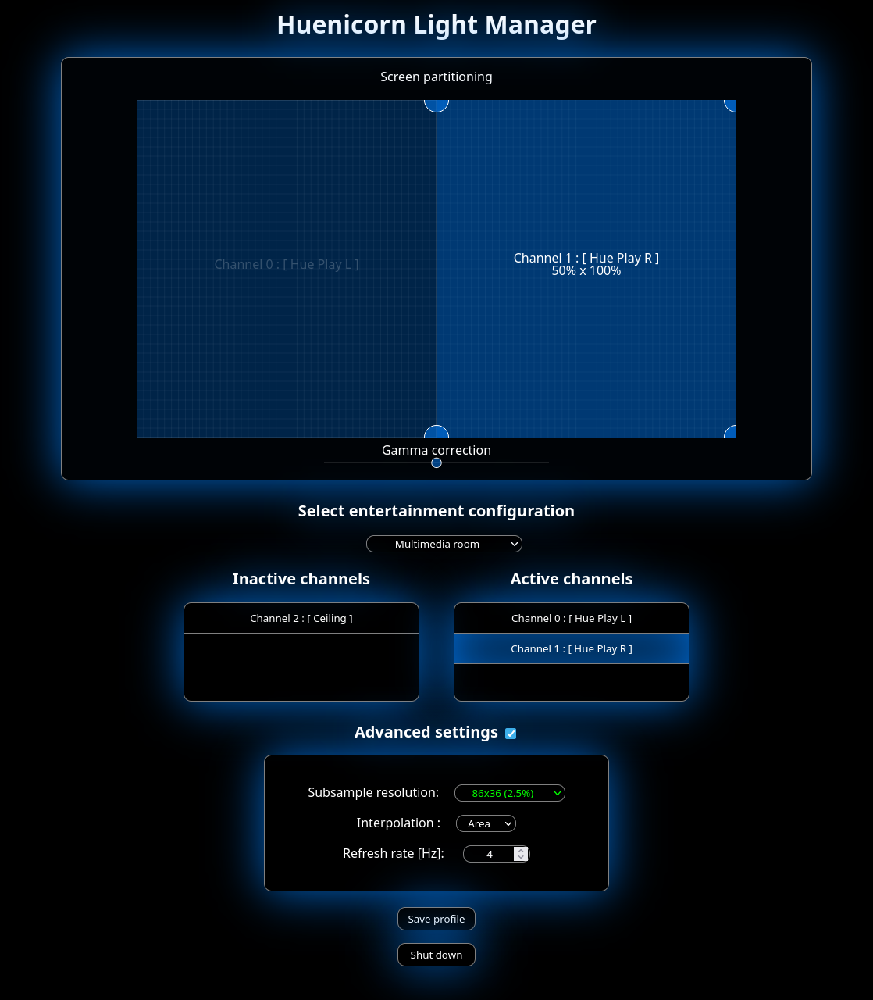

# Huenicorn

A free Philips Hue™ screen synchronizer for Gnu/Linux

<p align="center">
  
</p>

## Description

Huenicorn is a free ambilight driver for Gnu/Linux.
In other words, Huenicorn allows you to extend the colorful atmosphere of your computer screen to your Hue light bulbs in real-time.
Huenicorn provides a native Qt 6 graphical interface to assign specific portions of screen to the light bulbs you desire and save the settings for further entertainment sessions.
A legacy web interface is still available as an opt-in headless mode (see `--web` flag below).

### Screenshot

|  |
|:--:|
| *Caption: Huenicorn Light Manager user interface* |

## Project status

Huenicorn 1.0.11 is available.

### This revision brings

* Webroot files are now embeded to binary to make installation easier
* Initial setup now allows to select between multiple bridges if detected

## Getting Started

* Before using Huenicorn, you need to define some entertainment area on your Hue bridge through the official application provided by Philips.

### Requirements

* Gnu/Linux system running with graphics sessions based on X11 or Wayland
* Philips Hue bridge with registered lamps

### Dependencies

* [X.Org](https://xorg.freedesktop.org) or [Wayland](https://wayland.freedesktop.org)
* [Qt 6](https://www.qt.io) (Qt Quick / Qt QML, 6.8+)
* [OpenCV](https://github.com/opencv/opencv)
* [Crow](https://crowcpp.org/master)
* [Mbed-TLS](https://github.com/Mbed-TLS/mbedtls)
* [GLM](https://github.com/g-truc/glm)
* [nlohmann-json](https://github.com/nlohmann/json)
* [Curl](https://curl.se)

#### Dependencies intallation

<details>

<summary>ArchLinux</summary>

```bash
# Required dependencies
sudo pacman -S git cmake make gcc curl qt6-base qt6-declarative opencv mbedtls glm nlohmann-json
yay -S crow

# For X11 support
sudo pacman -S xorg-server

# For Wayland support
sudo pacman -S wayland glib2 pipewire
```

</details>

<details>

<summary>Fedora</summary>

```bash
# Required dependencies
sudo dnf install -y git cmake gcc gcc-c++ opencv-devel json-devel asio-devel curl-devel mbedtls-devel glm-devel

# For X11 support
sudo dnf install -y libXrandr-devel

# For Wayland support
sudo dnf install -y pipewire-devel glib2-devel

# Crow
# Download the zip available at : https://github.com/CrowCpp/Crow/releases/tag/v1.1.0
# Extract the archive and copy its content to the target directories:
sudo cp -r include/* /usr/local/include
sudo cp -r lib/* /usr/local/lib
```

</details>

<details>

<summary>OpenSUSE Tumbleweed</summary>

These dependencies needed to be installed on OpenSUSE Tumbleweed 20231011 to build and run Huenicorn:  

```bash
sudo zypper install opencv-devel libopencv408 python311-jsonschema asio-devel glm-devel nlohmann_json-devel

# For Wayland support
sudo zypper install pipewire-devel glib2-devel

# Crow
# Download the zip available at : https://github.com/CrowCpp/Crow/releases/tag/v1.1.0
# Extract the archive and copy its content to the target directories:
sudo cp -r include/* /usr/local/include
sudo cp -r lib/* /usr/local/lib

```

Additionally you have to build Mbed-TLS from source from the links above.
Follow the build instructions in their respective README files and copy them to the appropriate place, as some of them don't do that automatically (usually /usr/local/lib64/ for libraries (check LD_LIBRARY_PATH) or /usr/local/include/ for includes)

</details>

<details>

<summary>Ubuntu >= 22.04</summary>

```bash
# Add this repository for mbedtls, opencv
sudo add-apt-repository universe
sudo apt-get update

# Required dependencies
sudo apt-get install build-essential libopencv-dev libglm-dev libcurl4-openssl-dev nlohmann-json3-dev libmbedtls-dev libboost-all-dev

# For X11 support
sudo apt-get install libx11-dev libxext-dev libxrandr-dev

# For Wayland support
sudo apt-get install libglib2.0-dev libpipewire-0.3-dev wayland-utils

# Crow .deb installer can be downloaded from deb on their repository: https://github.com/CrowCpp/Crow/releases/tag/v1.0+5
sudo dpkg -i crow-v1.0+5.deb


# Make sure to use gcc/g++ v12
sudo apt install gcc-12 g++-12
sudo update-alternatives --install /usr/bin/gcc gcc /usr/bin/gcc-12 12
sudo update-alternatives --set gcc /usr/bin/gcc-12
sudo update-alternatives --install /usr/bin/g++ g++ /usr/bin/g++-12 12
sudo update-alternatives --set g++ /usr/bin/g++-12
```

Earlier versions of Ubuntu are not officially supported. Please refer to [This post](https://gitlab.com/openjowelsofts/huenicorn/-/issues/5#note_1700387996) if you still want to give it a try.

</details>

### Building Huenicorn

```bash
git clone https://gitlab.com/openjowelsofts/huenicorn.git
cd huenicorn
mkdir build && cd build
cmake ..
make
```

The output is a standalone executable called "huenicorn".

### Executing program

* Run the executable named "huenicorn" in the way you prefer (Terminal if you want some text feedback)
* The Qt 6 graphical interface opens automatically
* Run with the `--web` flag to use the legacy web UI instead: it is served at [127.0.0.1:8215](http://127.0.0.1:8215)
(port can be edited in configuration. Default is 8215). In that mode a browser spawns automatically
for the initial setup and as long as no light profile has been saved

#### Initial setup

When executed for the first time, Huenicorn shows a setup wizard in the Qt window. It consists of a step-by-step wizard to locate your Hue bridge on the network (auto-detection or manual IP address) and register an user on it (press the bridge's link button, then click "Pair").

Upon proper setup termination, Huenicorn resumes in its ordinary execution workflow and the main window opens.

#### Ordinary execution workflow

<details>
  <summary>Wayland-specific step</summary>
  <br/>

  At initialization, the grabber will ask you to select some source through a screen sharing portal. Pick the desired screen and validate by clicking "Share".
</details>
<br/>

Huenicorn will automatically select the suitable screen-grabber for the graphic session.

At startup, Huenicorn will look for a saved profile and start its color streaming execution.

In the main window, the left panel shows a preview of your screen with the zone allocated to each light. Select a light in the right-side list to edit its screen zone by dragging the corner handles, and adjust its gamma with the slider below the preview.

Use the switch next to each light to enable or disable its synchronization, and the combo box at the top of the side panel to switch between entertainment areas.

Once you are satisfied with the layout, click "Save profile" and it will be automatically reloaded for further executions.

### Configuration files

The configuration files can be found in your home directory at ~/.config/huenicorn/
config.json contains the bridge-related configuration.
profile.json contains the saved channels geometry for an entertainment configuration.

The data structure of these files is JSON.

#### config.json

  This file contains some parameters that can be manually edited after initial setup.

* **boundBackendIP**:  (String) IP address to bind the service on
* **bridgeAddress**:  (String) Address of the Philips Hue bridge
* **credentials**:
  * **clientkey**: (String) 32 hexadecimal characters key provided by initial setup
  * **username**: (String) Base64 or UUID username provided by initial setup
* **interpolation**:  (Unsigned) Identifier of the desired subsample interpolation function
  * Nearest = 0 : Cheapest. Low quality on high detail. Can cause the lights to flash
  * Cubic = 1 : Slow and harsh (kept for test)
  * Area = 2 : (Recommended) Smooth and respectful of overall content
* **profile**:  (String) Name of the current user-defined light profile
* **refreshRate**:  (Unsigned) Screen capture and light update frequency
* **restServerPort**:  (Unsigned) Port on which the web UI must respond
* **subsampleWidth**:  (Unsigned) Width of the treated image subsample

Here is an example

```json
{
  "boundBackendIP": "0.0.0.0",
  "bridgeAddress": "192.168.0.10",
  "credentials": {
    "clientkey": "01234567890ABCDEF0123456789ABCDE",
    "username": "AbCdEfGhIjKlMnOpQrStUvWxYz-0123456789012"
  },
  "interpolation": 2,
  "profileName": "profile",
  "refreshRate": 60,
  "restServerPort": 8215,
  "subsampleWidth": 32
}
```

#### profile.json

This file contains a list of channels related to an entertainment configuration.

* **Channels**: (Array) List of entertainment configuration channels
  * **active**: (Boolean) whether the channel is active or not
  * **channelId**: (Unsigned) Index of the channel in the entertainment configuration
  * **devices**: (Object) List of devices for the channel
    * **id**: (String) UUID of the device
    * **name**: (String) User-defined name of the device
    * **id**: (String) Manufacturer-defined name of the device
  * **gammaFactor**: (Float) Light brightness modifier
  * **uvs**: (Object) Pair of coorinates for sub image treatment
    * **uvA**: (Object) Top-left corner coordinate
      * **x**: (Float) x coordinate
      * **y**: (Float) y coordinate
    * **uvB**: (Object) Bottom-right corner coordinate
      * **x**: (Float) x coordinate
      * **y**: (Float) y coordinate
* **entertainmentConfigurationId**: (String) UUID of the related entertainment configuration

#### Shutting down

Huenicorn can be shut down through the "Shut down" button of the Qt interface (or the web interface in `--web` mode), or by sending a termination signal.

## Troubleshooting

### I can't see/select any entertainment area from the interface

This can happens if the credentials are invalidated for various reasons and can usually be fixed following these steps:

* Shutdown Huenicorn if running
* Remove (or rename) the ```~/.config/huenicorn/config.json``` file
* Restart Huenicorn
* Redo the initial setup and at the credentials step, press the "I don't have credentials yet" button
* Follow the instructions involving pressing the bridge's physical button and finish the setup

Huenicorn should now be able to properly list Entertainment Areas and stream colors

### My lights display raibow shift instead of my screen color

#### Reason

Huenicorn could not load any Grabber for the desktop session. It then loads the "Dummy grabber" to still allow access to the management panel and ensure bridge communication.

#### Solution

Check missing dependencies for the running session type

If you are unsure of the current session type, enter the following command:

```bash
echo $XDG_SESSION_TYPE
```

Then refer to the dependencies installation section for your distro.

The CMake output tells which Grabber is available for build:

```cmake
cmake ..
...
[cmake] Able to build X11 Grabber !
[cmake] Able to build Pipewire Grabber !
...
```

Wayland requires the ```Pipewire``` Grabber.

### Crash after screen selection on Wayland session

There is a known bug affecting Huenicorn depending on build parameters. This problem was "half-solved" since 1.0.9 but can somehow persist under certain circumstances.

Huenicorn can then be rebuilt with different optimisation flags to hopefully end with a functional result.

Clear the content of the ```build``` directory (if it exists).

Reconfigure the project with the following line instead of ~~```cmake ..```~~


```bash
cmake -DCMAKE_BUILD_TYPE=<CMakeBuildType> -DCMAKE_C_COMPILER=gcc -DCMAKE_CXX_COMPILER=g++ ..
make
```

```<CMakeBuildType>``` has to be replaced with one of the values below:

* Release
* MinSizeRel
* Debug
* RelWithDebInfo

Then try running Huenicorn again to see if it can now go beyond screen selection.

### Huenicorn still crashes immediately

Check the ```~/.config/huenicorn/config.json``` file and check the following properties:

```subsampleWidth``` : Must be higher than 0 and a divisor of your screen resolution.
```refreshRate``` : Must be between 1 and your screen refresh rate

## Website

Additionnal information and news can be found on [Huenicorn.org](http://huenicorn.org), the official website of the project.

## Version history

* 1.0.11 (latest)
  * Embed webroot into binary, handle multiple bridges at setup
* 1.0.10
  * Change default port, fix color computation, fix some minor bugs
* 1.0.9
  * Small step forward for fixing wayland crash
* 1.0.8
  * Global code restructuration and logo integration
* 1.0.7
  * Bug fixes for Wayland sessions
* 1.0.6
  * Library replacements and better compiler support
* 1.0.5
  * Add choice between subsampling interpolations in Web UI's advanced settings
* 1.0.4
  * Add support for Wayland graphic sessions
* 1.0.3
  * Move to Mbed-TLS 3.4
* 1.0.2
  * Performance improvement
* 1.0.1
  * Better reliability and documentation
* 1.0.0
  * First stable release
* 0.0.0 (Legacy)
  * Initial (slow) implementation using Hue HTTP API

## Authors

OpenJowel

## License

Huenicorn is licensed under the GNU GPLv3 License. See the [LICENSE.txt](LICENSE.txt) file for details.

## Acknowledgments

* [XDG portal screencast](https://codeberg.org/metamuffin/xdg-dp-start/src/branch/master/xdg-dp-start.c)
* [Pipewire documentation](https://docs.pipewire.org/page_tutorial5.html)
* [RGB D65 conversion](https://gist.github.com/popcorn245/30afa0f98eea1c2fd34d)
* [Huestacean](https://github.com/BradyBrenot/huestacean)
